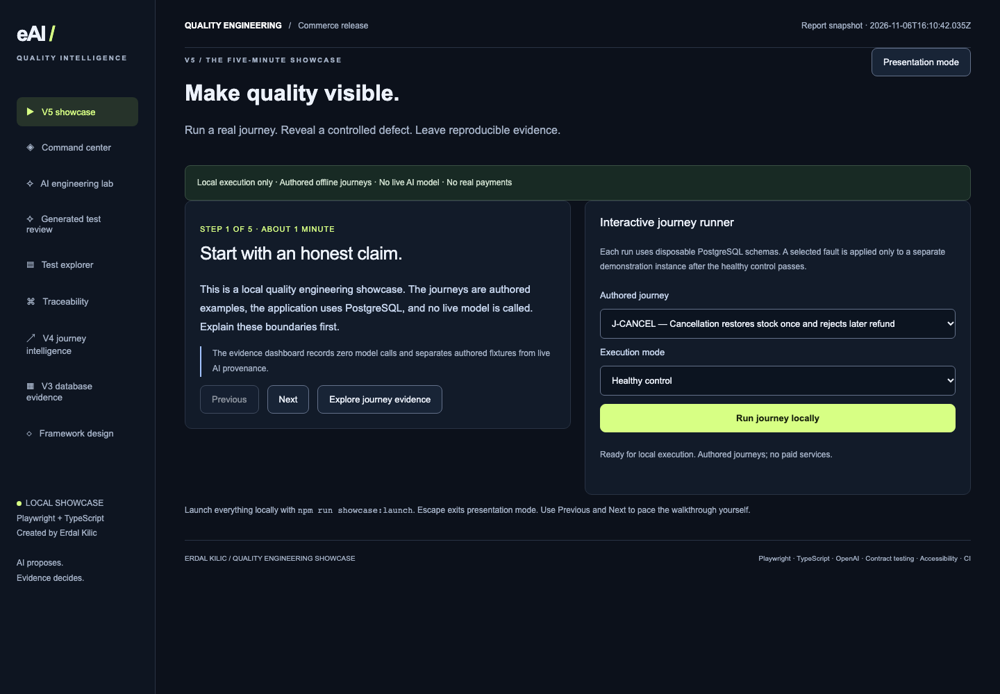
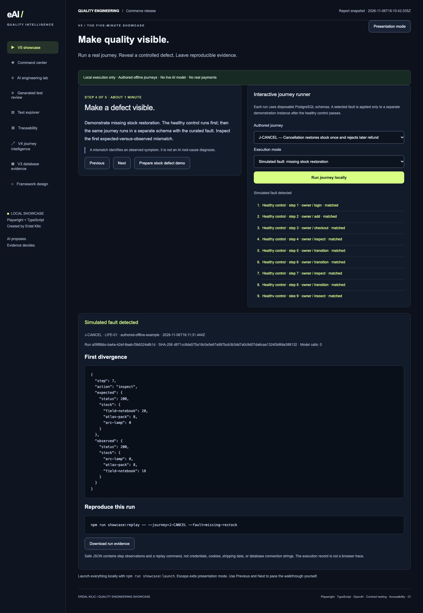

# eAI Quality Intelligence

**A local Playwright quality engineering showcase by Erdal Kilic.**

Run a real customer journey, reveal a controlled defect, and inspect evidence someone else can reproduce. V5 combines a guided presentation, streamed API observations, PostgreSQL commerce, and guarded AI workflow contracts.

**Current policy: local execution only.** Journey plans and AI examples are authored offline fixtures. Live model APIs, AWS uploads, and the five project GitHub Actions workflows are disabled. No API key is needed.

[](https://github.com/kilicerdal/playwright-ai-automation/releases/download/v5.0.0/v5-showcase-demo.webm)

[Watch or download the short demo](https://github.com/kilicerdal/playwright-ai-automation/releases/download/v5.0.0/v5-showcase-demo.webm) · [V5 release](https://github.com/kilicerdal/playwright-ai-automation/releases/tag/v5.0.0) · [Five-minute walkthrough script](docs/v5-walkthrough.md)

The silent recording captures actual local browser execution. It includes a healthy control, a simulated stock-restoration fault, its observed mismatch, and evidence export. Pauses pace the recording; they do not simulate execution progress.

## Start locally

Prerequisites: Node.js 22+, npm, PostgreSQL binaries on PATH (or `PG_BIN_DIR`), and Playwright browser binaries for browser checks. Install the project once:

```bash
npm ci
npx playwright install chromium firefox webkit
npm run showcase:launch
```

Open **http://127.0.0.1:4174/#showtime**. The commerce app is at **http://127.0.0.1:4175**. Its synthetic accounts are `demo` and `buyer2`, both using `demo-pass`.

The launcher checks ports, reuses compatible services, checks or starts the disposable loopback PostgreSQL lab, builds the dashboard, and starts missing processes. Ctrl+C stops only resources it started. It does not install packages, download models, call paid APIs, or deploy infrastructure. See [V5 setup and boundaries](docs/version-five.md).

Launch uses existing report snapshots. A fresh checkout may show missing evidence until you run the release checks:

```bash
npm run db:local:start
npm run verify:v5
npm run test:visual
```

The visual baseline is platform-specific. Review it on your target platform rather than silently replacing it.

## Demonstrate it in five minutes

1. Explain the local-only scope and authored provenance.
2. Run `J-CANCEL` in **Healthy control** mode.
3. Select **Simulated fault: missing stock restoration** and run again.
4. Inspect the first divergence: expected stock **20**, observed **18**.
5. Download safe JSON evidence and show the replay command.

```bash
npm run showcase:replay -- --journey=J-CANCEL --fault=missing-restock
```

The fault runs in a separate disposable schema after the healthy control passes. It does not corrupt the ordinary commerce demo. Results distinguish a passed control, a detected fault, and a fault that the selected journey misses. Infrastructure failures receive no defect-detection credit.



## Verified release scope

The local V5 release check passed **301 test executions**, representing **223 distinct test scenarios**:

| Suite                                                            | Executions |
| ---------------------------------------------------------------- | ---------: |
| Main API, security, AI contracts and four browser/device targets |        238 |
| PostgreSQL integration and journey evaluation                    |         51 |
| Showcase UI, streaming, evidence export and request guards       |         11 |
| Visual regression                                                |          1 |

The main run includes 77 API/security scenarios, 57 framework scenarios, and 26 browser scenarios repeated across Chromium, Firefox, WebKit and Pixel 7 emulation. Separate local evidence records eight authored journey controls detecting nine curated non-pricing faults, plus the earlier ten curated pricing faults. Nested mutation observations are not added to active test counts.

These are local results. V5 hosted workflows were deliberately disabled; no hosted V5 green run, exhaustive mutation coverage, or accessibility certification is claimed. [Verification details](docs/verification.md).

## What is implemented

| Area                  | Working behavior                                                                                                              |
| --------------------- | ----------------------------------------------------------------------------------------------------------------------------- |
| Guided showcase       | Five manually paced stages, presentation mode, keyboard controls                                                              |
| Interactive execution | Actual streamed step observations, independent expectations, safe downloads, replay CLI                                       |
| Durable commerce      | PostgreSQL migrations, immutable order prices, shared inventory, transactional checkout, simulated cancellation/refund        |
| Reliability           | Checkout replay, competing buyers, rollback, customer ownership, session isolation and CSRF                                   |
| AI workflow contracts | Grounded planning, quarantined drafts, cited investigation, review-only locator proposals and advisory impact selection       |
| AI boundaries         | Strict schemas, independent oracles, source/bundle hashes, human-attested candidate review; no generated JavaScript execution |
| Browser checks        | Four browser/device targets, selected axe scans, keyboard journeys, explicit visual baseline                                  |
| Evidence              | HTML, JUnit, JSON, retained failure traces, content hashes and reproducible execution records                                 |
| Delivery definitions  | Archived sharded GitHub workflows and optional AWS template; execution/upload disabled                                        |

## AI provenance and zero-spend policy

AI helped develop this project. That is separate from a live model generating tests at runtime. Current examples are **authored offline fixtures** and are labeled that way. They do not interpret an arbitrary question or establish model quality.

Live CLI commands reject execution, the Studio returns 403 for live requests, and the default OpenAI provider fails before constructing a network client. Mocked SDK contract tests remain local. Saved `.env` credentials stay ignored and are not used for live execution. AWS and hosted project workflows remain disabled even if old secrets exist. Re-enabling paid or hosted services requires deliberate changes and fresh authorization.

These are project controls, not an operating-system network sandbox or a guarantee about unrelated account activity. This application is intended for loopback use. Do not expose its synthetic demo accounts or local runner publicly.

## Useful commands

| Command                                                                 | Purpose                                                         |
| ----------------------------------------------------------------------- | --------------------------------------------------------------- |
| `npm run showcase:launch`                                               | Launch the local lab, commerce app and dashboard                |
| `npm run showcase:launch -- --check`                                    | Check startup and clean up owned resources                      |
| `npm run verify:v5`                                                     | Full local release checks and refreshed evidence                |
| `npm run test:visual`                                                   | Check the existing platform visual baseline                     |
| `npm run showcase:replay -- --journey=J-CANCEL --fault=missing-restock` | Reproduce a controlled divergence                               |
| `npm run journeys:evaluate`                                             | Run all authored journey controls and curated faults            |
| `npm run ai:demo`                                                       | Produce labeled authored AI workflow examples                   |
| `npm run ai:candidates`                                                 | Validate and quarantine authored candidate examples             |
| `npm run showcase:record`                                               | Record the actual local UI with the existing Playwright encoder |
| `npm run report`                                                        | Open the detailed Playwright report                             |

## Design and history

- [V5: guided showcase and streaming runner](docs/version-five.md)
- [V4: independent journey model and lifecycle faults](docs/version-four.md)
- [V3: durable commerce and reviewed candidate evaluation](docs/version-three.md)
- [V2: generation gates, sharded CI and historical test inventory](docs/version-two.md)
- [Architecture](docs/architecture.md), [test strategy](docs/test-strategy.md), and [AI workflow design](docs/ai-workflow.md)

Older documents describe earlier capabilities; the current zero-spend policy overrides their live API and deployment instructions. This is a portfolio reference implementation, with synthetic identities and simulated payments/refunds. Production adoption needs real identity and authorization, managed secrets, operational controls, workload testing, and organization-specific review.
