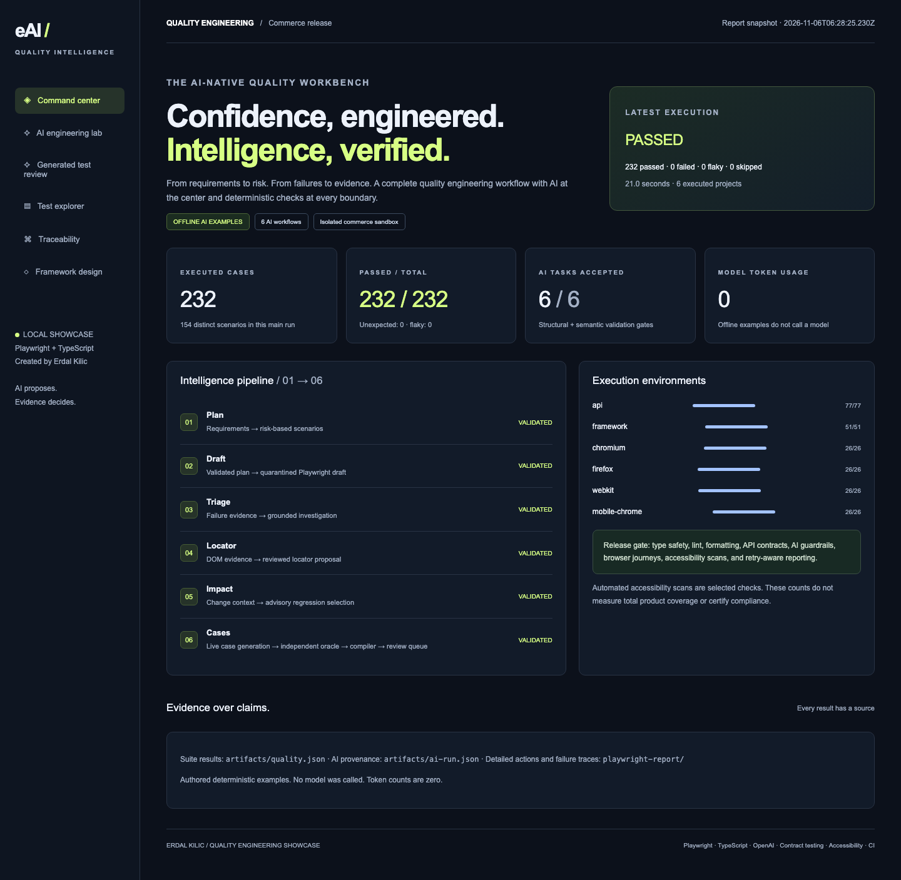
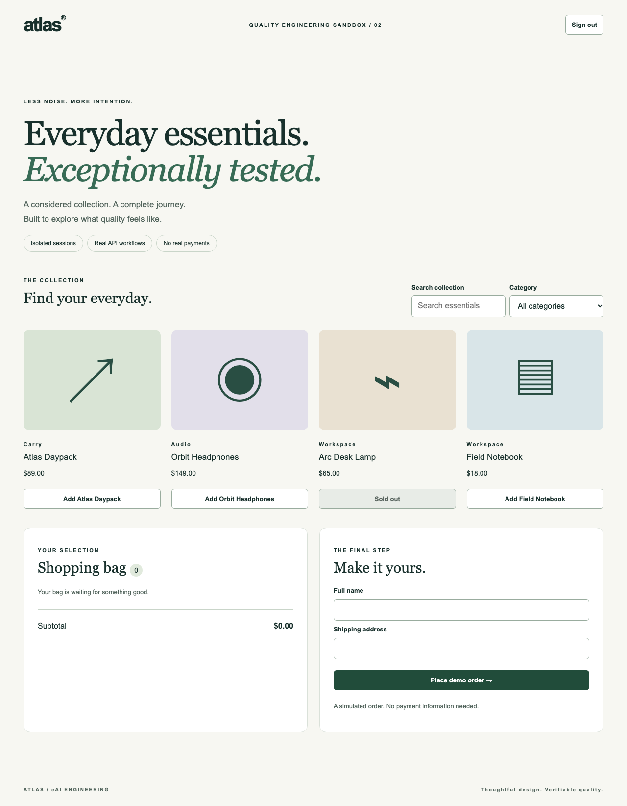
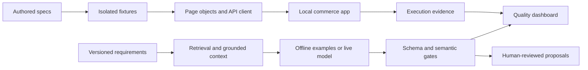

# eAI Quality Intelligence

**An AI-native Playwright engineering showcase by Erdal Kilic.**

A complete, reproducible commerce journey paired with an AI engineering workbench. Explore risk-based planning, guarded test generation, evidence-grounded failure investigation, locator proposals, and change-impact analysis—then inspect the deterministic tests that keep those proposals accountable.



## Version five — the guided showcase

V5 adds a real-time local journey runner, a five-step presentation guide, controlled fault demonstrations, safe downloadable evidence, and a single launcher. [V5 setup and walkthrough](docs/version-five.md).

```bash
npm run showcase:launch
# Open http://127.0.0.1:4174/#showtime
```

Requires installed Node.js 22+, project dependencies, Playwright browser binaries for browser tests, and PostgreSQL binaries for the local lab. The launcher checks and reuses compatible services; it never installs packages, downloads a model, calls paid APIs, or deploys cloud resources. It builds the dashboard from existing test evidence; run `npm run verify:v5` for fresh release results.

## Version four — local journey intelligence

V4 runs eight authored customer journeys through a constrained, typed plan interpreter and an independent reference model. It exercises nine actual non-pricing faults against isolated PostgreSQL applications, including ownership leaks, duplicate checkout, retained carts, and incorrect stock restoration. The dashboard links each requirement and journey hash to step-by-step expected and observed results. [V4 design and setup](docs/version-four.md).

```bash
npm run db:local:start
npm run verify:v4
npm run showcase
# Open http://127.0.0.1:4174/#journeys
```

**Zero-spend policy:** live API clients are blocked, AWS workflows are disabled, and hosted workflows have no automatic triggers and cannot allocate runners. Existing credentials remain ignored and untouched. No model is called or downloaded. Authored examples are explicitly labeled; V4 does not claim live AI generation. V2/V3 sections below describe historical capabilities; V4 policy overrides their live-generation instructions.

## Version three

V3 adds durable PostgreSQL commerce, transactional stock control, cancellation and simulated refunds, a versioned OpenAPI contract, failure reproduction bundles, and a human-reviewed AI case evaluator. The 40 new PostgreSQL integration tests cover persistence, races, rollback, ownership, browser journeys, and actual injected pricing faults. [V3 setup and evidence](docs/version-three.md).

```bash
npm run db:local:start  # requires installed PostgreSQL binaries
npm run verify:v3
npm run demo:postgres  # http://127.0.0.1:4175
```

Live AI generation remains pending API credits. The evaluation rehearsal uses explicitly labeled authored fixtures. AWS deployment remains disabled and formal template validation is pending.

## Version two

**160 distinct active tests**, six AI workflows, a generated-test review queue, independent expectation oracles, compiler gates, ten seeded-defect checks, and sharded CI. [Read the version-two design](docs/version-two.md).

```bash
npm run ai:candidates:live  # requires the local API key and model setting
# Inspect the quarantined draft and provenance in artifacts/candidates/
```

Live-generated candidates remain separate from authored/offline examples and active test counts. The optional [AWS summary archive](docs/aws-integration.md) is prepared but disabled; nothing deploys automatically.

## Experience it in five minutes

Requires **Node.js 22+** and npm. No API key is needed for the suite or authored demo.

```bash
npm ci
npx playwright install --with-deps chromium firefox webkit
npm run verify
npm run showcase
```

Open **http://127.0.0.1:4174**. The Generated test review panel shows validation, provenance, and curated defect-detection evidence. Explore the command center, run an offline task in **AI engineering lab → Interactive AI Studio**, search test results, and follow requirement-to-test mappings.

To browse the application under test separately:

```bash
npm run demo:app
# http://127.0.0.1:4173 — account: demo / demo-pass
```



## What the showcase demonstrates

| Area                    | Working implementation                                                                                          |
| ----------------------- | --------------------------------------------------------------------------------------------------------------- |
| AI planning             | Requirement retrieval, risk scenarios, requirement-ID and coverage-shape validation                             |
| AI generation           | Structured Playwright drafts, static review checks, quarantined output                                          |
| AI investigation        | Evidence citations, uncertainty, hypotheses and next checks                                                     |
| AI maintenance          | Review-only locator suggestions; advisory change-impact selection                                               |
| AI reliability          | Strict schemas, two-attempt limit, provider timeout, token accounting, prompt version and input hash            |
| Functional automation   | UI, API and end-to-end checkout workflows; API-based browser setup                                              |
| Data and authentication | Session isolation, rotation, invalidation, CSRF, strict payload contracts                                       |
| Reliability             | Concurrency/idempotency tests, HTTP failure recovery, lost-response retry                                       |
| Browser coverage        | Chromium, Firefox, WebKit and Pixel 7 emulation                                                                 |
| Accessibility           | Automated WCAG-tagged axe scans and keyboard-only login                                                         |
| Visual regression       | Separate explicit snapshot suite and baseline-review workflow                                                   |
| Reporting               | HTML, JUnit, JSON, traces, screenshots, video, requirement mapping and interactive results                      |
| Delivery                | Read-only GitHub Actions permissions, quality/audit gate, evidence artifacts, Docker recipe, dependency updates |

## Use a real AI model

```bash
cp .env.example .env
# In .env, set OPENAI_API_KEY and AI_MODEL to a model available to your project.
npm run ai:live
npm run showcase:build
npm run showcase
```

The Studio also supports individual live tasks after the server loads those environment variables. Live calls use OpenAI's Responses API and structured output. They can incur API charges. A Studio session permits ten live tasks, each with at most two model calls; CLI runs make five tasks with the same two-attempt bound.

**Offline mode is explicitly authored example output.** It does not call a model or interpret the question. Live mode never silently falls back to examples. The adapter is contract-tested with a mocked SDK; a live end-to-end run requires credentials and account access.

A plan passing the gates establishes structure, references, and required coverage categories. It does **not** prove every scenario is correct. Generated code is never executed automatically. Static review checks are not a sandbox. [Read the AI design and limits](docs/ai-workflow.md).

## Commands

| Command                                                  | Purpose                                                                       |
| -------------------------------------------------------- | ----------------------------------------------------------------------------- |
| `npm run verify`                                         | Typecheck, lint, formatting, full suite, offline AI artifacts, showcase tests |
| `npm test`                                               | API, security, AI framework, and four browser/device targets                  |
| `npm run test:smoke`                                     | Fast API + Chromium business checks                                           |
| `npm run test:api`                                       | API and security suites                                                       |
| `npm run test:a11y`                                      | Chromium accessibility checks                                                 |
| `npm run test:resilience`                                | Network failure and lost-response cases                                       |
| `npm run test:framework`                                 | AI provider contracts and guardrail regression cases                          |
| `npm run test:visual:update`                             | Create/update the current platform's reviewed baseline                        |
| `npm run test:visual`                                    | Compare against that baseline                                                 |
| `npm run ai:demo`                                        | Build five explicitly authored AI examples                                    |
| `npm run ai:live`                                        | Run five real model tasks; requires credentials                               |
| `npm run ai:live -- --results=test-results/results.json` | Investigate actual Playwright evidence instead of the synthetic incident      |
| `npm run report`                                         | Open the detailed Playwright HTML report                                      |
| `npm run showcase`                                       | Serve the results dashboard and interactive AI Studio                         |

## Architecture



```text
demo/                     Local commerce UI and HTTP API
requirements/             Versioned business requirements
src/ai/                   Providers, task contracts, gates and retrieval
src/api/                  Typed API client and response contracts
src/fixtures/             Per-test authentication and browser setup
src/pages/                User-oriented browser interactions
src/reporters/            Retry-aware quality and requirement evidence
tests/                    API, security, UI, E2E, resilience, accessibility, visual, AI, Studio
scripts/                  AI CLI, report builder, local Studio server, CI summary
artifacts/                Generated evidence and quarantined drafts (ignored)
showcase/                 Portable generated HTML report (ignored)
```

## Walk through the engineering

- [Seven-minute demonstration](docs/showcase-guide.md)
- [Architecture and decisions](docs/architecture.md)
- [Test strategy and visual baselines](docs/test-strategy.md)
- [AI workflow, controls and limitations](docs/ai-workflow.md)
- [Setup, troubleshooting and maintenance](docs/runbook.md)
- [Verification record](docs/verification.md)

## Scope and honesty

This is a portfolio reference implementation of enterprise engineering patterns. The demo uses in-memory state, one public demo identity, per-session simulated stock and orders, and no payments. It is intended for loopback access; do not expose the demo or Studio publicly. It is not a production commerce system, penetration test, accessibility certification, or load-test certification. A real enterprise rollout adds durable storage, real identity and permissions, managed secrets, approved environments, retention policies, observability and organization-specific security review.

Results shown in the dashboard come from local artifacts. Browser/device repetitions count as separate executions. Passing checks do not mean exhaustive coverage. Docker and hosted GitHub Actions require separate execution in those environments; local verification does not establish a hosted green build.
