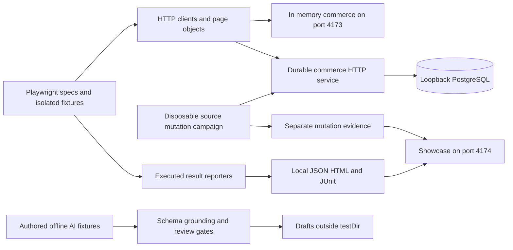

# Architecture and engineering decisions

## Current V5 system boundaries

The current checkout includes both the isolated in-memory application and a durable PostgreSQL commerce implementation. The latter owns shared inventory, persisted price snapshots, transactional checkout and replay behavior. Source mutations run in disposable copies against the local database lab; their observations are separate from the main test execution count. Specs own assertions, while clients and pages own interactions.

The showcase reads recorded evidence and streams explicitly selected local journeys. It does not infer that a model ran or that a hosted workflow passed. Live model calls, cloud uploads and all project hosted workflows remain disabled. Current execution evidence is linked in [verification history](verification.md) and the [mutation guide](local-mutation-testing.md).

## Original in memory design

The following decisions describe the original in-memory service and explain its limits. They do not describe the later shared PostgreSQL implementation.

**Atlas Commerce** is the deterministic application under test, served on loopback port 4173. It implements a real HTTP session, catalog, cart and checkout workflow. The HTTP API uses strict input validation, integer cents, session-bound CSRF tokens and idempotency keys. There is no dependency on a public demo site.

**Quality Intelligence** is a generated evidence report plus a local AI Studio on port 4174. The report reads `artifacts/quality.json` and `artifacts/ai-run.json`. It does not manufacture result counts. The Studio invokes task-specific providers with bounded, explicit context; it cannot run shell commands or execute generated tests.

## Test boundaries

- Specs own business intent and assertions.
- Page objects own browser interactions and accessible locators.
- `CommerceClient` owns HTTP transport, headers and request shapes.
- Fixtures establish one isolated API session per test and transfer its cookie to the browser when needed. Session cleanup runs after test usage.
- Browser state is never shared across tests or written as a reusable authentication file.
- APIs and AI guardrails run once each; browser journeys run separately across four targets.
- Tests tag requirement IDs; the reporter maps executed cases to those tags.

## Decisions and tradeoffs

| Decision                        | Reason                                                       | Tradeoff                                              |
| ------------------------------- | ------------------------------------------------------------ | ----------------------------------------------------- |
| Local in-memory service         | Reliable setup and no shared public data                     | No durable persistence or distributed locking         |
| Per-session stock/cart/orders   | Parallel runs without reset endpoints                        | Stock does not represent a shared warehouse           |
| Integer cents                   | Exact money arithmetic                                       | One currency and no tax/shipping engine               |
| Idempotent checkout             | Handles duplicate submissions and lost responses             | Keys persist only for the session lifetime            |
| API browser setup               | Fast, isolated authentication                                | Separate UI sign-in tests are still required          |
| Lexical retrieval               | Small corpus, inspectable relevance, no embedding dependency | Not a vector database or semantic retrieval benchmark |
| Model proposals outside testDir | Preserve trust boundary and prevent accidental execution     | Human promotion step is required                      |
| One repair opportunity          | Recover schema/semantic defects with bounded calls           | Some otherwise useful answers will be rejected        |
| No silent healing               | Preserve meaningful test failures                            | Maintenance requires a reviewed change                |
| Full suite after impact advice  | Avoid model-driven coverage gaps                             | Selection is advisory, not a CI optimization          |
| Explicit visual suite           | Make baseline approval deliberate                            | Baselines vary by platform and need review            |

## Archived CI design

The archived quality job defines type checking, ESLint, formatting and a dependency advisory gate. Its test job defines browser installation and suites with `forbidOnly` and failure on flaky tests, plus report uploads. These definitions are disabled in the current zero-spend setup; they are not evidence that hosted V5 execution or uploads occurred.

The archived live-AI workflow describes a named GitHub environment, but runtime calls are disabled in the current project. Re-enabling paid providers or hosted services requires deliberate implementation changes and fresh authorization.

## Production adoption

Replace the demo identity with real authentication; use durable transaction and idempotency storage; support HTTPS and Secure cookies; add operational limits, load testing, monitoring, real dependency contracts, environment provisioning and organizational data-handling controls. The reference design deliberately keeps those integration points explicit rather than simulating them as production-ready infrastructure.
